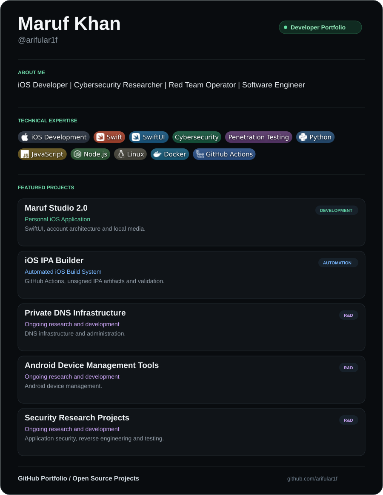

<picture>
  <source media="(max-width: 600px)" srcset="assets/profile-card-mobile.svg">
  
</picture>

  <a href="https://github.com/arifular1f">GitHub Portfolio</a>
  ·
  <a href="https://github.com/arifular1f?tab=repositories">Open Source Projects</a>

Read profile details, project notes and public activity

## About Me

iOS Developer | Cybersecurity Researcher | Red Team Operator | Software Engineer

I'm **Maruf Khan**, known on GitHub as **@arifular1f**. I build iOS applications and developer tools with Swift, SwiftUI, Python, JavaScript and Node.js. My wider technical focus includes Linux server administration, Docker and virtualization, application reverse engineering, penetration testing and red team operations.

## Technical Expertise

## Featured Projects

### Maruf Studio 2.0 — Personal iOS Application

An independently developed SwiftUI application with a customizable interface, navigation, themes, account architecture and local-media management.

- Native SwiftUI screens and reusable interface components.
- Google Sign-In architecture prepared for real OAuth configuration.
- Customizable tabs, discovery preferences and playback settings.
- Native Simulator tests and an automated unsigned IPA build.

### iOS IPA Builder — Automated iOS Build System

A Windows-friendly development workflow that uses GitHub-hosted macOS builds to compile an iOS application and package an unsigned IPA.

- XcodeGen project generation and installed toolchain detection.
- Build logs, artifact upload and automated artifact download.
- IPA structure, application metadata and SHA-256 verification.
- VS Code tasks and a lightweight browser interface prototype.

### Private DNS Infrastructure

Ongoing research and development in DNS infrastructure and administration.

### Android Device Management Tools

Ongoing research and development in Android device management.

### Security Research Projects

Ongoing research into application security, reverse engineering, penetration testing and red team methodologies.

The infrastructure, Android and security entries are ongoing R&D overviews. Implementation details, source files and operational configuration are not published in this profile.

## Public GitHub Activity

The statistics card refreshes weekly from public profile data and includes its update date. View my [contribution activity](https://github.com/arifular1f?tab=overview) and [public repositories](https://github.com/arifular1f?tab=repositories).

## Connect

[GitHub — @arifular1f](https://github.com/arifular1f)

