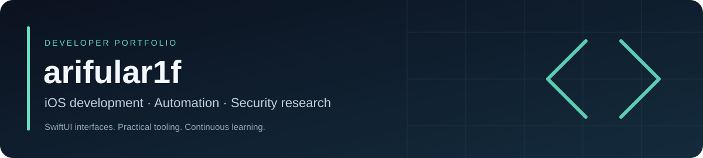
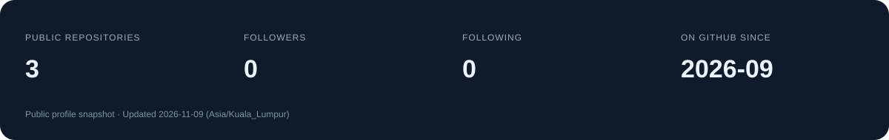

# Hi, I'm arifular1f

I build iOS applications and developer tools, with a focus on SwiftUI, automation, and application security. I use Swift, Python, JavaScript, and Node.js across app development, supporting utilities, and build workflows.

My wider technical interests include Linux server administration, Docker and virtualization, application reverse engineering, penetration testing, and red team operations.

[GitHub profile](https://github.com/arifular1f) · [Public repositories](https://github.com/arifular1f?tab=repositories) · [Contribution activity](https://github.com/arifular1f?tab=overview)

## Technical focus

| Area | Focus |
| --- | --- |
| iOS development | Swift, SwiftUI, native interfaces, navigation, and app architecture |
| Automation and tooling | Python, JavaScript, Node.js, Git, and repeatable developer workflows |
| Build engineering | GitHub Actions, CI/CD, automated iOS builds, and artifact validation |
| Infrastructure | Linux server administration, Docker, and virtualization |
| Security research | Application reverse engineering, penetration testing, and red team methodologies |

## Project highlights

### Maruf Studio 2.0 — Personal iOS app

An independently developed SwiftUI application with a customizable interface, navigation, themes, account architecture, and local-media management.

- Native SwiftUI screens and reusable interface components.
- Google Sign-In architecture prepared for OAuth configuration.
- Customizable tabs, discovery preferences, and playback settings.
- Native Simulator tests and an automated unsigned IPA build.

**Focus:** iOS application development · Swift · SwiftUI · Application architecture

### iOS IPA Builder — GitHub Actions automation

A Windows-friendly development workflow that uses GitHub-hosted macOS builds to compile an iOS application and package an unsigned IPA.

- XcodeGen project generation and installed toolchain detection.
- Build logs, artifact upload, and automated artifact download.
- IPA structure, application metadata, and SHA-256 verification.
- VS Code tasks and a lightweight browser interface prototype.

**Focus:** GitHub Actions · CI/CD · Python · Node.js · Developer automation

## Ongoing research and development

| Area | Current scope |
| --- | --- |
| Private DNS Infrastructure | Ongoing research and development in DNS infrastructure and administration. |
| Android Device Management | Ongoing research and development in Android device management. |
| Cybersecurity Research Projects | Ongoing study of application security, reverse engineering, penetration testing, and red team operations. |

**Status:** Ongoing research and development. These are high-level overviews; implementation details stay outside this profile.

## GitHub statistics and contributions

The statistics card refreshes weekly from public GitHub profile data and includes its update date. Explore my [contribution calendar and recent activity](https://github.com/arifular1f?tab=overview) or browse my [public repositories](https://github.com/arifular1f?tab=repositories).

## Connect

Find me on [GitHub — @arifular1f](https://github.com/arifular1f).
